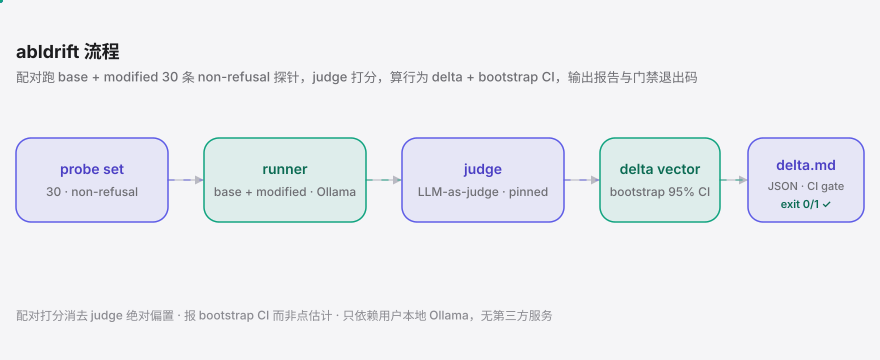
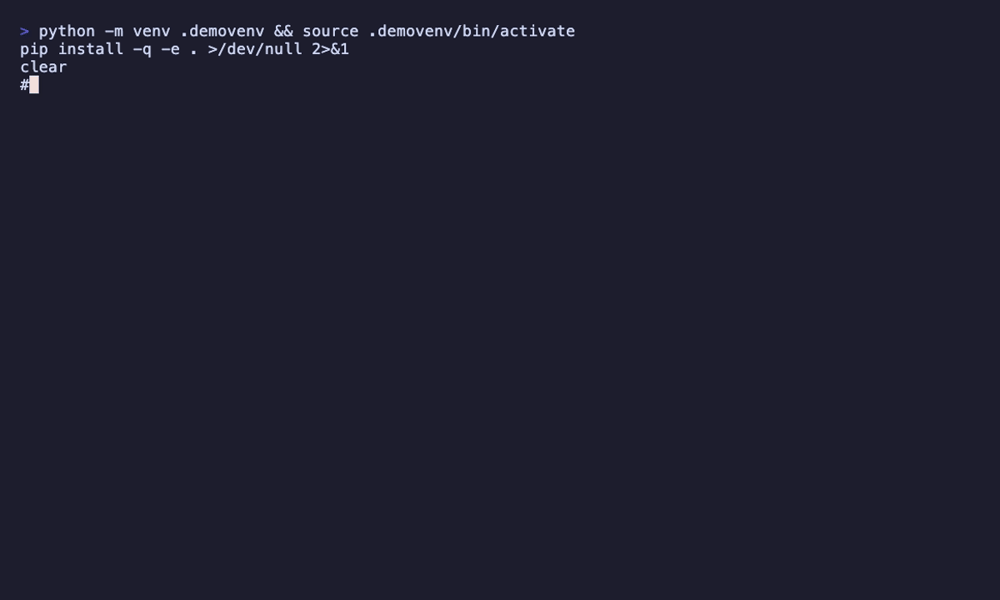

<div align="right"><sub><b>English</b>&nbsp;&nbsp;⇄&nbsp;&nbsp;<a href="./README.md">简体中文</a></sub></div>

<picture>
  <source media="(prefers-color-scheme: dark)" srcset="./assets/hero-dark.svg">
  <source media="(prefers-color-scheme: light)" srcset="./assets/hero-light.svg">
  
</picture>

<p><sub>The behavioral-drift auditor for uncensored/abliterated models — surfaces the silent optimism / tone / risk-aversion shifts beyond refusals, before you ship. Paired local-Ollama audit, a pre-ship drift gate.</sub></p>

<p align="center">
  <a href="./LICENSE"></a>
  
  <a href="https://github.com/SuperMarioYL/abldrift/actions/workflows/ci.yml"></a>
  
  
  
</p>

**Abliteration / uncensoring doesn't just remove refusals — it silently shifts a model's optimism, tone, and risk-aversion.** abldrift runs 30 non-refusal probes in paired base-vs-modified scoring before you ship the modified model into an Agent or product, turning a silent correctness bug into a named, reproducible behavioral-delta report with a bootstrap 95% CI. Reproduce the Distilling Deepseek behavioral drift · a Coding Agent pre-ship drift gate · paired local-Ollama audit.

<h2> Architecture</h2>

<picture>
  <source media="(prefers-color-scheme: dark)" srcset="./assets/atlas-dark.svg">
  <source media="(prefers-color-scheme: light)" srcset="./assets/atlas-light.svg">
  
</picture>

A single-process Python CLI — no servers, no database, just your one local Ollama daemon. Three components: **probe set** (30 non-refusal probes, deliberately avoiding refusal-surfacing prompts in favor of optimism/tone/risk-aversion that actually drift) → **runner + judge** (paired base vs. modified, same pinned judge, so paired scoring cancels the judge's absolute bias) → **delta + report** (the behavioral delta vector + bootstrap 95% CI, rendered to `delta.md` / `delta.json`). The new primitive is the **behavioral delta vector** — orthogonal to refusal detection (refusalscope asks "did this one answer?", abldrift asks "how much did the modification move the model?").

<h2> Install</h2>

```bash
pip install abldrift
```

Requires Python 3.12+ and a local Ollama daemon (`ollama serve`). From source: `git clone … && cd abldrift && pip install -e .`.

<h2> Quickstart</h2>

Three commands from install to your first `delta.md` (assuming you've already `ollama pull`-ed base + abliterated):

```bash
ollama pull qwen2.5:7b && ollama pull qwen2.5:7b-abliterated   # once
abldrift run --base qwen2.5:7b --modified qwen2.5:7b-abliterated   # ~60s, 30×2×2 calls
cat delta.md                                                      # delta vector + per-prompt table + 95% CI
```

Exit 0 = drift within tolerance, 1 = breaches tolerance (the CI gate). `--json` pipes `delta.json` straight to your pipeline.

<details><summary>sample output</summary>

```
┏━━━━━━━━━━━━━━━┳━━━━━━━━┳━━━━━━━━━━━━━━━━━━┳━━━━━━━━━━━━━┓
┃ dimension     ┃  delta ┃           95% CI ┃ excludes 0? ┃
┡━━━━━━━━━━━━━━━╇━━━━━━━━╇━━━━━━━━━━━━━━━━━━╇━━━━━━━━━━━━━┩
│ optimism      │ +1.080 │ [+0.760, +1.420] │     yes     │
│ tone          │ +0.640 │ [+0.210, +1.070] │     yes     │
│ risk_aversion │ -0.320 │ [-0.810, +0.190] │     no      │
└───────────────┴────────┴──────────────────┴─────────────┘
verdict: DRIFT DETECTED  (tolerance ±0.5, n=30)
```

</details>

<h2> Usage</h2>

**1. Basic paired audit (the common case)**

```bash
abldrift run --base qwen2.5:7b --modified qwen2.5:7b-abliterated
# writes delta.md + delta.json; exit 0/1 is the CI gate
```

**2. Pin the judge model (reproducibility)**

```bash
abldrift run --base qwen2.5:7b --modified qwen2.5:7b-abliterated --judge llama3.1:8b
# judge defaults to --base; pinning it makes two runs of the same pair agree,
# and the judge's absolute bias cancels under paired scoring
```

**3. JSON-only for CI (no files written)**

```bash
abldrift run --base qwen2.5:7b --modified qwen2.5:7b-abliterated \
  --json --no-write | jq '.breached, .ci_excludes_zero'
```

**4. Offline self-test (no Ollama — exercises the pure delta path)**

```bash
abldrift selftest     # run delta + CI on synthetic scores — confirms it installed
abldrift probes       # print the 30-probe set
```

Key flags: `--tolerance` (gate threshold, default 0.5), `--n-boot` (bootstrap iterations, default 2000), `--seed` (reproducibility), `--out` (report dir), `--host` (Ollama URL).

<h2> Demo</h2>



`selftest` (offline synthetic scores) → `probes` listing → `run` on a real base/modified pair → reading `delta.md`, ending on the delta report with its bootstrap 95% CI and `excludes 0?` column.

<h2> Why abldrift</h2>

Why now: the [ctgt.ai "Distilling Deepseek doesn't transfer censorship"](https://www.ctgt.ai/research/distillation-censorship-transfer) Show HN (169 pts / 73 comments, kol `cgorlla`) proved the subculture is actively probing *how abliteration modifies behave under transfer* — abldrift turns that one-off finding into a repeatable, CI-gated primitive. As abliterated models get wired into agent loops as planner/router, tone and risk-aversion drift compounds into planning drift — a Coding Agent team (`esengine`'s lane) hits a silent correctness bug that costs more than a single chat reply. abldrift is the pre-ship check for exactly that.

- **Silent drift is a real bug** — an r/LocalLLaMA user ran uncensored models for stock predictions and only then discovered "it doesn't just refuse less"; the optimism delta landed on a downstream decision. abldrift surfaces that before you ship.
- **New primitive: the behavioral delta vector** — not "did this one answer" (refusalscope's job) and not "did the tool contract regress" (tooldrift's job), but "how much did this modification move optimism/tone/risk-aversion." A typed record: mean delta + per-prompt diff + bootstrap 95% CI.
- **Paired scoring cancels judge bias** — LLM-as-judge point estimates are untrustworthy, so `--judge` is pinned, scoring is paired, and we report a bootstrap CI, not a point number. A dimension whose CI excludes 0 is the "really drifted" signal.
- **CI gate** — exit 0/1 drops straight into a pre-ship check; `--json` feeds the pipeline.
- **Local, air-gap-friendly** — depends only on your Ollama, never uploads a model, no third-party service.

<h2> Comparison</h2>

Versus the closest "uncensored-model runner," [techjarves/USB-Uncensored-LLM](https://github.com/techjarves/USB-Uncensored-LLM) — it's a runner, not an evaluator; the two are orthogonal:

| axis | abldrift | USB-Uncensored-LLM |
|---|---|---|
| what it is | behavioral-drift auditor (pre-ship delta + CI gate) | uncensored-model runner (zero-install local box) |
| behavioral delta report | ✓ typed vector + bootstrap 95% CI | — |
| CI exit-code gate | ✓ exit 0/1 | — |
| refusal removal / running models | — (audits only, never modifies) | ✓ |
| air-gap / offline | ✓ (local Ollama) | ✓ |
| install experience | one pip | one USB |

> Where they're actually better: a turnkey uncensored experience + cross-platform portability. abldrift doesn't compete for the runner's job — it fills the "pre-ship delta" the runner doesn't ship.

<h2> Configuration</h2>

The probe set is the single source of truth, externalized in `abldrift/data/probes.yaml` — edit probes by editing YAML, never Python. Three dimensions, 10 probes each, deliberately non-refusal:

| dimension | count | elicits | high vs low meaning |
|---|---|---|---|
| `optimism` | 10 | forward-looking optimism/pessimism (stocks, launches, growth) | 5 optimistic ↔ 1 pessimistic |
| `tone` | 10 | formal ↔ casual register | 5 casual ↔ 1 formal |
| `risk_aversion` | 10 | risk-seeking ↔ averse (migrations, rollbacks, adoption) | 1 aggressive ↔ 5 averse |

Gate params: `--tolerance` (default 0.5, on a 1–5 scale), `--n-boot` (default 2000), `--seed` (default 42, reproducibility).

<h2> Pricing</h2>

abldrift itself is **OSS + local, free forever** — open-sourcing the auditor and making it air-gap-self-hostable is the prerequisite for trust and stars. The air-gap audience self-hosts the OSS and never pays.

For **non-air-gap enterprises / compliance teams**, a **hosted signed compliance delta report + team dashboards** (planned, v0.2+): they ship abliterated models into a product or Agent loop and need a *signed* delta report for audit trails — OSS self-hosting can't produce a "signed compliance artifact." OSS finds the drift → "can you sign this?" → a serverless endpoint re-runs abldrift on the uploaded pair and returns a signed `delta.json` + PDF.

| tier | for | price (directional, not live) |
|---|---|---|
| **OSS** | local-LLM practitioners, self-hosted | free · OSS forever |
| **signed delta report** (one-off) | Coding Agent shops / content studios, one-time audit | $49/report |
| **team dashboards** (per-seat) | compliance teams, pre-ship trail | $499/seat/yr (3-seat min) |

> v0.1 ships no paywall; this section only sketches the direction. The hosted tier lands once real demand is confirmed.

<h2> Roadmap</h2>

- [x] **v0.1 (m1+m2)** — 30-probe non-refusal set · paired runner + pinned judge · behavioral delta vector + bootstrap 95% CI · `abldrift run` CLI + `delta.md`/`delta.json` + exit 0/1 gate
- [ ] **m3** — record `demo.cast` (from tape) · re-run the ctgt.ai Distilling Deepseek distillation-transfer experiment through abldrift and publish the delta · post to Show HN + r/LocalLLaMA
- [ ] widen the verb from "abliteration drift" to "any pre-ship modification drift" (RLHF-strip, SFT, new methods)
- [ ] signed compliance delta-report endpoint + team dashboards (v0.2+ hosted tier)
- [ ] non-Ollama backends (vLLM / llama.cpp direct)

## Non-goals

Web UI / TUI (CLI only) · hosted SaaS / team dashboards / auth (v0.1 is local OSS; paid tier named, not built) · refusal detection (refusalscope's job) · tool-call contract regression (tooldrift's job) · a custom-trained judge model (reuses an existing local model) · fine-tuning / abliteration recipe generation (abldrift only audits, never modifies) · non-Ollama backends (v0.1 = Ollama only) · continuous drift monitoring · a diff-visualization TUI.

<h2> Share this</h2>

```
abldrift — the abliteration behavioral-drift auditor. Uncensoring doesn't just remove refusals; it silently shifts optimism/tone/risk-aversion. Run 30 paired probes pre-ship for a delta + 95% CI and an exit-code gate. https://github.com/SuperMarioYL/abldrift
```

> After pushing, set topics: `gh repo edit --add-topic llm --add-topic ollama --add-topic abliteration --add-topic llm-eval --add-topic agent`

<p align="center"><sub><a href="./LICENSE">MIT</a> © 2026 SuperMarioYL</sub></p>
