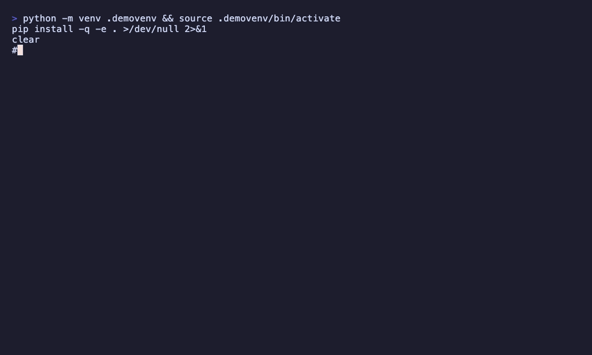

[English](README.en.md) | **简体中文**

<picture>
  <source media="(max-width: 640px) and (prefers-color-scheme: dark)" srcset="assets/presentation/hero-mobile-dark.svg">
  <source media="(max-width: 640px)" srcset="assets/presentation/hero-mobile-light.svg">
  <source media="(prefers-color-scheme: dark)" srcset="assets/presentation/hero-dark.svg">
  
</picture>

**比较基线与修改版的乐观度、语气和风险规避评分，生成可检查的漂移报告。**

`v0.1.0` · `Python 3.12+` · [MIT](LICENSE)

[Website](https://abldrift.lei6393.com) · [Demo record](docs/demo-results.json)

## 为什么使用

模型修改后，回答风格可能发生变化。abldrift 把同一组问题的两份评分逐条对齐，用三个维度的均值差和重采样区间展示变化，便于发布前审阅。评分来自评审模型，结果仍取决于问题集和评分质量。

## 架构

<picture>
  <source media="(max-width: 640px) and (prefers-color-scheme: dark)" srcset="assets/presentation/architecture-mobile-dark.svg">
  <source media="(max-width: 640px)" srcset="assets/presentation/architecture-mobile-light.svg">
  <source media="(prefers-color-scheme: dark)" srcset="assets/presentation/architecture-dark.svg">
  
</picture>

探针 YAML 定义问题与维度；runner 通过 Ollama 获取两组回答并交给同一 judge。delta 模块计算 modified − base，report 输出表格、Markdown 和 JSON。门禁依据均值差是否超过 tolerance，置信区间是单独展示的统计信息。

源码入口：[abldrift/cli.py](abldrift/cli.py) · [abldrift/delta.py](abldrift/delta.py) · [abldrift/runner.py](abldrift/runner.py) · [abldrift/judge.py](abldrift/judge.py) · [abldrift/report.py](abldrift/report.py) · [abldrift/data/probes.yaml](abldrift/data/probes.yaml)

## 安装

源码安装需要 Python 3.12+ 与 uv。下面的 selftest 无需 Ollama；在线审计需另行准备实际可用的模型标签与服务。

```bash
git clone https://github.com/SuperMarioYL/abldrift.git
cd abldrift
uv venv --python 3.12
uv pip install --python .venv/bin/python -e .
```

## 快速开始

两个命令使用内置合成分数，验证 delta、bootstrap 和容差判定。没有调用实际模型；selftest 的退出码均为 0，不是 run 的 CI 退出码演示。

```bash
.venv/bin/abldrift selftest --seed 42 --tolerance 0.5
.venv/bin/abldrift selftest --seed 42 --tolerance 1.1
```

完整输入与执行步骤见上方命令及 [Demo 记录](docs/demo-results.json)。

## 使用

```bash
.venv/bin/abldrift probes --probes abldrift/data/probes.yaml
.venv/bin/abldrift selftest --n-boot 2000 --seed 42
```
在线命令形状为 `abldrift run --base BASE --modified MODIFIED --judge JUDGE --out reports`，其中三个大写值必须替换为本机模型标签。`--json` 输出 JSON，`--no-write` 表达不写报告的意图。run 的约定是通过 0、超过容差 1、捕获到运行错误 2。当前版本在线评分对象与 delta 输入不匹配，在线流程应先修复并验证，再用于发布门禁。

## 实际 Demo

<picture>
  <source media="(max-width: 640px) and (prefers-color-scheme: dark)" srcset="assets/presentation/process-mobile-dark.svg">
  <source media="(max-width: 640px)" srcset="assets/presentation/process-mobile-light.svg">
  <source media="(prefers-color-scheme: dark)" srcset="assets/presentation/process-dark.svg">
  
</picture>

### 默认容差

均值差在三个维度上都超过 0.5。

```text
$ .venv/bin/abldrift selftest --seed 42 --tolerance 0.5
  abldrift — synthetic-base → synthetic-modified  (judge:
                          (none))
┏━━━━━━━━━━━━━━━┳━━━━━━━━┳━━━━━━━━━━━━━━━━━━┳━━━━━━━━━━━━━┓
┃ dimension     ┃  delta ┃           95% CI ┃ excludes 0? ┃
┡━━━━━━━━━━━━━━━╇━━━━━━━━╇━━━━━━━━━━━━━━━━━━╇━━━━━━━━━━━━━┩
│ optimism      │ +1.000 │ [+1.000, +1.000] │     yes     │
│ tone          │ +0.800 │ [+0.800, +0.800] │     yes     │
│ risk_aversion │ +0.600 │ [+0.600, +0.600] │     yes     │
└───────────────┴────────┴──────────────────┴─────────────┘
verdict: DRIFT DETECTED  (tolerance ±0.5, n=30)
optimism: delta=+1.000 CI=[+1.000,+1.000] excludes0=True
tone: delta=+0.800 CI=[+0.800,+0.800] excludes0=True
risk_aversion: delta=+0.600 CI=[+0.600,+0.600] excludes0=True
```

### 增大容差

容差变为 1.1 后判定通过，分数与区间没有变化。

```text
$ .venv/bin/abldrift selftest --seed 42 --tolerance 1.1
  abldrift — synthetic-base → synthetic-modified  (judge:
                          (none))
┏━━━━━━━━━━━━━━━┳━━━━━━━━┳━━━━━━━━━━━━━━━━━━┳━━━━━━━━━━━━━┓
┃ dimension     ┃  delta ┃           95% CI ┃ excludes 0? ┃
┡━━━━━━━━━━━━━━━╇━━━━━━━━╇━━━━━━━━━━━━━━━━━━╇━━━━━━━━━━━━━┩
│ optimism      │ +1.000 │ [+1.000, +1.000] │     yes     │
│ tone          │ +0.800 │ [+0.800, +0.800] │     yes     │
│ risk_aversion │ +0.600 │ [+0.600, +0.600] │     yes     │
└───────────────┴────────┴──────────────────┴─────────────┘
verdict: within tolerance  (tolerance ±1.1, n=30)
optimism: delta=+1.000 CI=[+1.000,+1.000] excludes0=True
tone: delta=+0.800 CI=[+0.800,+0.800] excludes0=True
risk_aversion: delta=+0.600 CI=[+0.600,+0.600] excludes0=True
```

## 能力与接入

<picture>
  <source media="(max-width: 640px) and (prefers-color-scheme: dark)" srcset="assets/presentation/integrations-mobile-dark.svg">
  <source media="(max-width: 640px)" srcset="assets/presentation/integrations-mobile-light.svg">
  <source media="(prefers-color-scheme: dark)" srcset="assets/presentation/integrations-dark.svg">
  
</picture>

离线 selftest 只执行评分计算。完整 run 路径面向 Ollama；报告用于审阅或流水线消费。它不修改模型，也不评估所有安全性或任务能力。


## 配置

`--tolerance=0.5` 控制绝对均值差阈值，`--n-boot=2000` 与 `--seed=42` 控制重采样。`--probes` 指向 YAML，`--host` 指定 Ollama 地址。每条评分范围为 1–5；无法解析的 judge 输出会退回中性分数，因此应结合原始输出审阅。

## 路线图与范围

已提供探针集、离线计算和报告模块。优先修复并验证在线评分连接；其他服务后端、持续监控与托管报告属于后续方向。

- 配对 judge 不保证消除评分偏差，bootstrap 区间也不证明模型修改导致了真实世界效果。
- 当前真实 Ollama run 链路存在 ScoredResponse 与 ResponseScore 接口不匹配；此示例仅覆盖可运行的离线核心。

 · [Recording script](docs/demo.tape)

## 许可证

[MIT](LICENSE)
